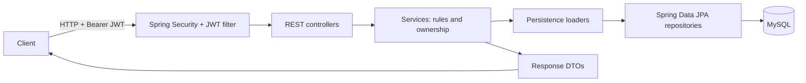

# After

[](https://github.com/lorentelimaethan/after-backend/actions/workflows/ci.yml)


**A REST API for private events hosted in personal spaces.** Create an event, discover events by type or music style, and manage attendance through host-controlled actions. This repository contains the After v1 backend API, not a web or mobile client.

Built with Java 21, Spring Boot 4, Spring Web MVC, Spring Data JPA, MySQL, Spring Security, JJWT, BCrypt, Jakarta Validation, and Maven. Springdoc OpenAPI 3 and Swagger UI describe the HTTP API. Docker Compose provides a local After and MySQL stack.

## What it does

- **Accounts:** register, log in, log out, view profiles, and edit your own profile or display name.
- **Events:** create, list, filter, view, update, and delete events.
- **Attendance:** join or leave an event; hosts can invite or remove attendees when their role allows it.
- **Access control:** signed JWTs, a stateless Spring Security filter chain, method-level permissions, and host checks in the service layer.
- **API contracts:** validated request DTOs and public response DTOs. Event responses include an attendee count, not the attendee list or address.
- **Concurrent capacity control:** event writes use transactions and a database row lock so simultaneous joins, invitations, and capacity updates cannot overfill an event.

The host is stored separately from attendees. Capacity counts attendees only. Joining twice, exceeding capacity, or joining/leaving as the host is rejected. Invitations and removals require both the relevant role permission and event ownership; hosts cannot invite or remove themselves.

## How it fits together



The code is organized under `src/main/java/com/afterApp/after/`: `controller` handles HTTP, `service` enforces business rules, `loader` wraps persistence operations, `repositories` access Spring Data JPA, `entity` defines the JPA model, `dto` defines API payloads, and `mappers` converts between entities and DTOs. The project also has in-memory caches for selected event reads, request timing logs, and a global exception handler.

## Run locally

### Docker Compose

**Requirements:** Docker Engine with Compose.

1. Copy the environment template and set the required database, JWT, and development-admin credentials. Generate a Base64-encoded JWT key with `openssl rand -base64 32`.

   ```bash
   cp .env.example .env
   ```

   `.env` is ignored by Git and excluded from the Docker build context; `.env.example` contains placeholders only.

2. Build and start both services:

   ```bash
   docker compose up --build
   ```

   Compose runs After with the `dev` profile and a MySQL service. The API is available at `http://localhost:8081`; Swagger UI is at `http://localhost:8081/swagger-ui/index.html`.

3. Check the running services and health endpoint:

   ```bash
   docker compose ps
   curl http://localhost:8081/actuator/health
   ```

Stop the stack with `docker compose down`. MySQL data persists in the `mysql_data` volume.

### Java and local MySQL

**Requirements:** Java 21 and a local MySQL server. The Maven Wrapper is included.

1. Create the database:

   ```sql
   CREATE DATABASE after;
   ```

2. Set the JWT signing key and development bootstrap-admin details in your shell:

   ```bash
   export JWT_SECRET="$(openssl rand -base64 32)"
   export AFTER_ADMIN_USERNAME='admin'
   export AFTER_ADMIN_PASSWORD='<your-local-admin-password>'
   export AFTER_ADMIN_NAME='After'
   export AFTER_ADMIN_LASTNAME='Admin'
   export AFTER_ADMIN_EMAIL='admin@after.local'
   export AFTER_ADMIN_PHONE_NUMBER='+34000000000'
   ```

   The default `dev` profile connects to `jdbc:mysql://localhost:3306/after` as `root` with an empty password. Override these defaults with `DATABASE_URL`, `DATABASE_USERNAME`, and `DATABASE_PASSWORD` if needed.

3. Start the API:

   ```bash
   ./mvnw spring-boot:run
   ```

Both startup methods expose the API at `http://localhost:8081` and the public health endpoint at `/actuator/health`.

The `test` profile uses in-memory HSQLDB for the regular test suite. For production, activate `prod` with `SPRING_PROFILES_ACTIVE=prod`. `DATABASE_URL`, `DATABASE_USERNAME`, `DATABASE_PASSWORD`, and `JWT_SECRET` are required. Production exposes only Actuator `health` and `info`; only `health` is public. A bootstrap administrator is never created in production. The Compose setup above is for local development, not production deployment.

### Try the core flow

Register a user:

```bash
curl -X POST http://localhost:8081/after/v1/auth/register \
  -H 'Content-Type: application/json' \
  -d '{"username":"host01","password":"password123","name":"Alex","lastname":"Rivera","email":"alex@example.com","phoneNumber":"+34612345678"}'
```

Registration returns the plain-text message `Usuario creado correctamente`. Log in with `POST /after/v1/auth/login` and `{"username":"host01","password":"password123"}`. The response body is the JWT itself as text, rather than a JSON object. Send it on protected requests:

```http
Authorization: Bearer <token>
```

Create an event:

```bash
curl -X POST http://localhost:8081/after/v1/events \
  -H 'Authorization: Bearer <token>' \
  -H 'Content-Type: application/json' \
  -d '{
    "name": "Friday at home",
    "eventType": "HOUSE_PARTY",
    "musicStyle": "HOUSE",
    "description": "Small private gathering",
    "dateTime": "2030-06-15T21:00:00",
    "capacity": 12,
    "address": {
      "street": "Carrer de la Marina",
      "streetNum": "25",
      "postalCode": "08005",
      "city": "Barcelona",
      "province": "Barcelona",
      "additionalInfo": ""
    }
  }'
```

The response is an `EventResponseDTO` with `id`, `name`, `description`, `dateTime`, `capacity`, `eventType`, `musicStyle`, `hostDisplayName`, and `usersCount`. It does not return the address or attendees.

## API reference

All routes below use the `/after/v1` prefix. Only registration and login are public; logout and the remaining routes require `Authorization: Bearer <token>`.

| Method | Path | Action |
| --- | --- | --- |
| `POST` | `/auth/register` | Register; assigns the `FREE` role |
| `POST` | `/auth/login` | Return a JWT as plain text |
| `POST` | `/auth/logout` | Invalidate the supplied token in this application instance |
| `GET` | `/users/{id}` | Get a public profile, or private fields for your own profile |
| `PUT` | `/users/{id}` | Update your own profile |
| `PATCH` | `/users/{id}/display-name` | Change your own display name |
| `PATCH` | `/users/{id}/role` | Change a user's role; requires `UPDATE_ROLE` |
| `DELETE` | `/users/{id}` | Delete your own account and hosted events; leave events you attended; returns `204` |
| `GET` | `/events` | List events; optional `type` and `style` query parameters |
| `GET` | `/events/{id}` | Get an event |
| `POST` | `/events` | Create an event as host |
| `PATCH` | `/events/{id}` | Update event details; host only |
| `PATCH` | `/events/{id}/join` | Join as an attendee |
| `PATCH` | `/events/{id}/leave` | Leave as an attendee |
| `PATCH` | `/events/{eventId}/invite/user/{userId}` | Invite; host + `INVITE_USER` permission |
| `DELETE` | `/events/{eventId}/kick/user/{userId}` | Remove attendee; host + `KICK_USER` permission |
| `DELETE` | `/events/{id}` | Delete; host only, returns `204` |

For example, `GET /after/v1/events?type=AFTER&style=TECHNO` filters by both fields. Accepted `type` values are `AFTER`, `PREVIA`, `HOUSE_PARTY`, `CHILL`, `CLUB`, and `POOL_PARTY`; accepted `style` values are `REGGAETON`, `TECHNO`, `TEKNO`, `HOUSE`, `POP`, and `MIXED`.

### Roles and responses

Roles are initialized on startup. A bootstrap admin account is created only with the `dev` and `test` profiles if its username does not exist; its values are supplied through `AFTER_ADMIN_*` environment variables in development.

| Role | Permissions |
| --- | --- |
| `FREE` | `VIEW_EVENT`, `CREATE_EVENT`, `ACCESS_EVENT`, `VIEW_USER`, `UPDATE_USER`, `UPDATE_EVENT`, `DELETE_EVENT`, `KICK_USER` |
| `PREMIUM` | All `FREE` permissions plus `INVITE_USER` |
| `ADMIN` | All `PREMIUM` permissions plus `UPDATE_ROLE` and `VIEW_METRICS` |

Permissions determine whether a user can attempt an action. Event ownership remains a separate business rule: only the event host can invite, remove attendees, update, or delete that event. This also applies to `ADMIN`; an administrator is not a moderator of events hosted by other users.

`GET /users/{id}` exposes only `id` and `displayName` for another user. For your own profile, it also returns `name`, `lastname`, `phoneNumber`, `email`, and `roleName`. Password hashes and credential entities are never part of these response DTOs.

Expected API failures are mapped to `400` (invalid input or state), `401` (missing or invalid authentication), `403` (permission denied), `404` (missing resource), or `409` (conflict). Most errors use `{ "status", "error", "message", "path", "timestamp" }`; DTO validation failures return a map of field names to messages. Some ownership checks on user profile updates currently return `400`.

Registration returns `409` for an existing username. Unexpected database failures are not returned with raw SQL details in the API response.

### Concurrent events and account deletion

Joining, leaving, inviting, kicking, updating, and deleting an event acquire a pessimistic write lock on that event inside a `READ_COMMITTED` transaction. Capacity checks and attendee changes happen while the lock is held. A host is not counted as an attendee, and a capacity reduction below the current attendee count is rejected.

Deleting an account is transactional: the user is removed from events they attended, their hosted events are deleted, and other attendees keep their accounts. Event caches are cleared after a successful account-deletion commit.

## Development and tests

```bash
./mvnw test
```

Tests use JUnit 5, Mockito, and MockMvc. Maven activates the `test` profile, so the regular HTTP tests use in-memory HSQLDB from `src/test/resources/application-test.properties`; local MySQL is not needed for those tests.

MySQL integration tests use Testcontainers and require a running Docker daemon. They cover persistence, account deletion with event relationships, and concurrent attendance or capacity changes: join + join, invite + invite, join + invite, capacity reduction + join, leave + join, kick + join, and event deletion + join. Run them locally with:

```bash
AFTER_RUN_MYSQL_TESTS=true ./mvnw -Dtest=MySqlContainerTest test
```

Run the entire suite, including MySQL, with `AFTER_RUN_MYSQL_TESTS=true ./mvnw test`. The GitHub Actions workflow in `.github/workflows/ci.yml` runs `./mvnw clean verify` on Java 21 with the MySQL tests enabled, Maven dependency caching, and a downloadable JaCoCo coverage report. `./mvnw verify` writes the local report to `target/site/jacoco/index.html`.

The local application uses Hibernate `ddl-auto=update`. JWTs expire after one hour; logout adds tokens to an in-memory blocklist, which is lost on restart and is not shared between instances. Event and user reads use an in-memory cache, so this configuration targets a single application instance. Database migrations, shared token revocation, and multi-instance cache coordination are not implemented here.
