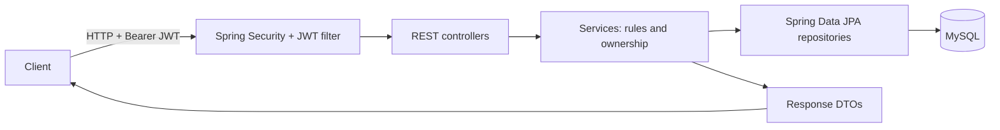

# After

[](https://github.com/lorentelimaethan/after-backend/actions/workflows/ci.yml)


**A REST API for private events hosted in personal spaces.** Create an event, discover events by type or music style, and manage attendance through host-controlled actions. After is currently a backend MVP; this repository does not contain a web or mobile client.

Built with Java 21, Spring Boot 4, Spring Web MVC, Spring Data JPA, MySQL, Spring Security, JJWT, BCrypt, Jakarta Validation, and Maven. OpenAPI annotations and Swagger UI describe the HTTP API.

## What it does

- **Accounts:** register, log in, log out, view profiles, and edit your own profile or display name.
- **Events:** create, list, filter, view, update, and delete events.
- **Attendance:** join or leave an event; hosts can invite or remove attendees when their role allows it.
- **Access control:** signed JWTs, a stateless Spring Security filter chain, method-level permissions, and host checks in the service layer.
- **API contracts:** validated request DTOs and public response DTOs. Event responses include an attendee count, not the attendee list or address.

The host is stored separately from attendees. Capacity counts attendees only. Joining twice, exceeding capacity, or joining/leaving as the host is rejected. Invitations and removals require both the relevant role permission and event ownership; hosts cannot invite or remove themselves.

## How it fits together



The code is organized under `src/main/java/com/afterApp/after/`: `controller` handles HTTP, `service` enforces business rules, `repositories` access persistence, `entity` defines the JPA model, `dto` defines API payloads, and `mappers` converts between entities and DTOs. The project also has in-memory caches for selected event reads, request timing logs, and a global exception handler.

## Run locally

**Requirements:** Java 21 and a local MySQL server. The Maven Wrapper is included.

1. Create the database:

   ```sql
   CREATE DATABASE after;
   ```

2. Check `src/main/resources/application.properties`. Its local defaults use `jdbc:mysql://localhost:3306/after`, user `root`, an empty password, and port `8081`. Set `JWT_SECRET` to a Base64-encoded signing key for any non-local environment. The configured secret fallback and bootstrap admin credentials are development defaults; change them before running outside a trusted local setup.

3. Start the API:

   ```bash
   ./mvnw spring-boot:run
   ```

The API runs at `http://localhost:8081`. Swagger UI is configured at `http://localhost:8081/swagger-ui/index.html`; the public health endpoint is `/actuator/health`.

### Try the core flow

Register a user:

```bash
curl -X POST http://localhost:8081/after/v1/auth/register \
  -H 'Content-Type: application/json' \
  -d '{"username":"host01","password":"password123","name":"Alex","lastname":"Rivera","email":"alex@example.com","phoneNumber":"+34612345678"}'
```

Registration returns the plain-text message `Usuario creado correctamente`. Log in with `POST /after/v1/auth/login` and `{"username":"host01","password":"password123"}`. The response body is the JWT itself as text, rather than a JSON object. Send it on protected requests:

```http
Authorization: Bearer <token>
```

Create an event:

```bash
curl -X POST http://localhost:8081/after/v1/events \
  -H 'Authorization: Bearer <token>' \
  -H 'Content-Type: application/json' \
  -d '{
    "name": "Friday at home",
    "eventType": "HOUSE_PARTY",
    "musicStyle": "HOUSE",
    "description": "Small private gathering",
    "dateTime": "2030-06-15T21:00:00",
    "capacity": 12,
    "address": {
      "street": "Carrer de la Marina",
      "streetNum": "25",
      "postalCode": "08005",
      "city": "Barcelona",
      "province": "Barcelona",
      "additionalInfo": ""
    }
  }'
```

The response is an `EventResponseDTO` with `id`, `name`, `description`, `dateTime`, `capacity`, `eventType`, `musicStyle`, `hostDisplayName`, and `usersCount`. It does not return the address or attendees.

## API reference

All routes below use the `/after/v1` prefix. Registration and login are public; the remaining routes require `Authorization: Bearer <token>`.

| Method | Path | Action |
| --- | --- | --- |
| `POST` | `/auth/register` | Register; assigns the `FREE` role |
| `POST` | `/auth/login` | Return a JWT as plain text |
| `POST` | `/auth/logout` | Invalidate the supplied token in this application instance |
| `GET` | `/users/{id}` | Get a public profile, or private fields for your own profile |
| `PUT` | `/users/{id}` | Update your own profile |
| `PATCH` | `/users/{id}/display-name` | Change your own display name |
| `PATCH` | `/users/{id}/role` | Change a user's role; requires `UPDATE_ROLE` |
| `DELETE` | `/users/{id}` | Delete your own account; returns `204` |
| `GET` | `/events` | List events; optional `type` and `style` query parameters |
| `GET` | `/events/{id}` | Get an event |
| `POST` | `/events` | Create an event as host |
| `PATCH` | `/events/{id}` | Update event details; host only |
| `PATCH` | `/events/{id}/join` | Join as an attendee |
| `PATCH` | `/events/{id}/leave` | Leave as an attendee |
| `PATCH` | `/events/{eventId}/invite/user/{userId}` | Invite; host + `INVITE_USER` permission |
| `DELETE` | `/events/{eventId}/kick/user/{userId}` | Remove attendee; host + `KICK_USER` permission |
| `DELETE` | `/events/{id}` | Delete; host only, returns `204` |

For example, `GET /after/v1/events?type=AFTER&style=TECHNO` filters by both fields. Accepted `type` values are `AFTER`, `PREVIA`, `HOUSE_PARTY`, `CHILL`, `CLUB`, and `POOL_PARTY`; accepted `style` values are `REGGAETON`, `TECHNO`, `TEKNO`, `HOUSE`, `POP`, and `MIXED`.

### Roles and responses

Roles are initialized on startup. A bootstrap admin account is also created if its username does not exist; its `after.admin.*` values live in `application.properties`.

| Role | Permissions |
| --- | --- |
| `FREE` | `VIEW_EVENT`, `CREATE_EVENT`, `ACCESS_EVENT`, `UPDATE_USER`, `VIEW_USER` |
| `PREMIUM` | All `FREE` permissions plus `INVITE_USER` |
| `ADMIN` | All `PREMIUM` permissions plus `KICK_USER`, `DELETE_EVENT`, `UPDATE_ROLE` |

`GET /users/{id}` exposes only `id` and `displayName` for another user. For your own profile, it also returns `name`, `lastname`, `phoneNumber`, `email`, and `roleName`. Password hashes and credential entities are never part of these response DTOs.

Expected API failures are mapped to `400` (invalid input or state), `401` (missing or invalid authentication), `403` (permission denied), `404` (missing resource), or `409` (conflict). Most errors use `{ "status", "error", "message", "path", "timestamp" }`; DTO validation failures return a map of field names to messages. Some ownership checks on user profile updates currently return `400`.

## Development and tests

```bash
./mvnw test
```

Tests use JUnit 5, Mockito, and MockMvc. HTTP tests start the Spring context against an in-memory HSQLDB configured in `src/test/resources/application.properties`, so local MySQL is not needed for the test suite. The pull request workflow in `.github/workflows/ci.yml` runs `./mvnw clean verify` on Java 21.

The local application uses Hibernate `ddl-auto=update`. JWTs expire after one hour; logout adds tokens to an in-memory blocklist, which is lost on restart and is not shared between instances. Event and user reads use an in-memory cache, so this configuration targets a single application instance. Database migrations, shared token revocation, and multi-instance cache coordination are not implemented here.
